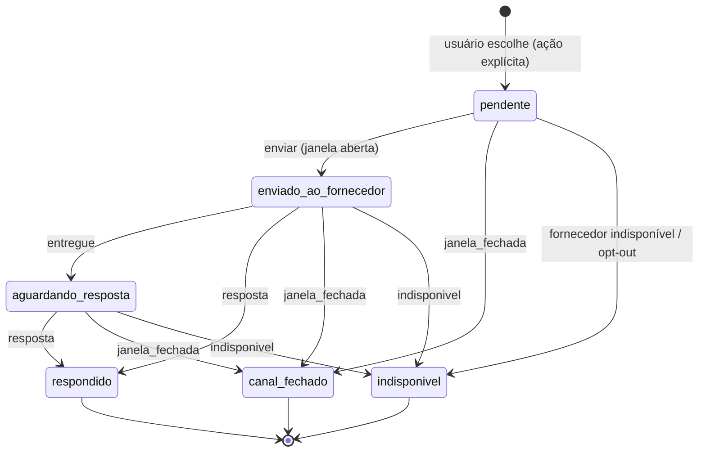
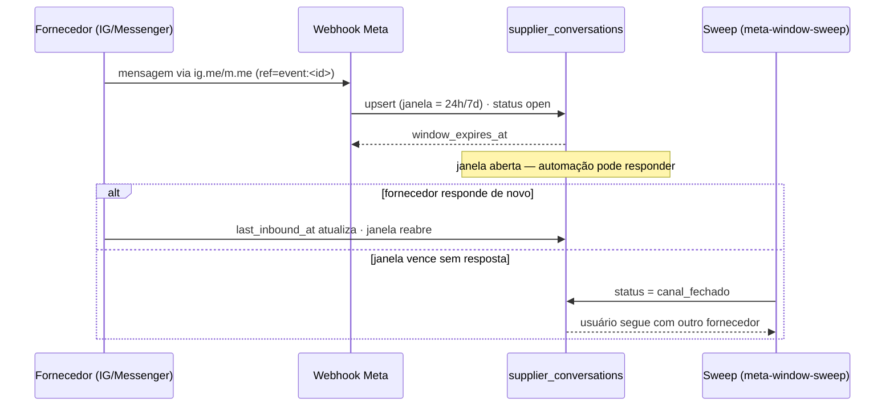
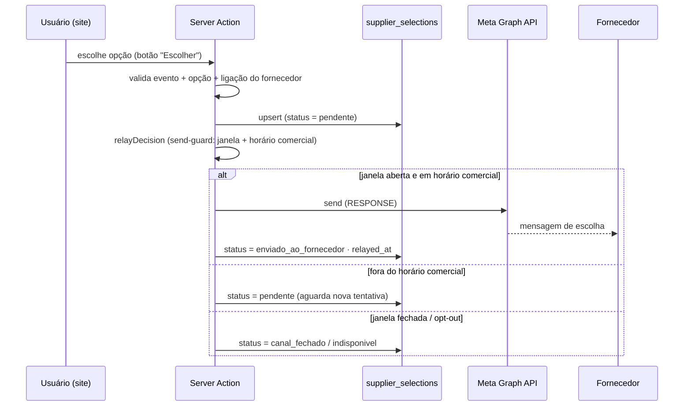
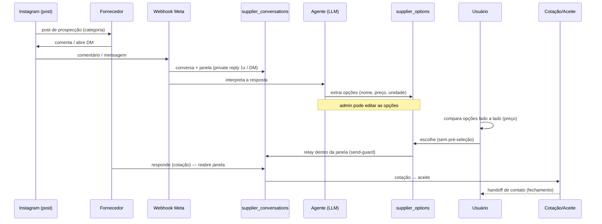

# Fluxo de seleção de produtos (nível de categoria)

> Documento operacional da seleção de produtos da EventeIA. Última revisão: 2026-10-31.
> Regras de plataforma vinculantes: [AGENTS.md](../AGENTS.md) e
> [docs/canais-meta.md](./canais-meta.md). Implementação: `lib/selection/`,
> migração aditiva `0065_supplier_options.sql`.

## 1. Visão geral

A seleção acontece no **nível de categoria** (não há catálogo itemizado): cada fornecedor
registra a **categoria/tema** e uma **lista de opções** (ex.: buffet → churrasco, jantar;
louça → vários jogos). As opções são extraídas das respostas do fornecedor no chat
(o agente extrai; o admin pode editar).

- **Quem escolhe é sempre o usuário.** O sistema **nunca** pré-seleciona, marca default ou
  recomenda uma opção automaticamente.
- A escolha é enviada ao fornecedor **somente dentro da janela aberta** (send-guard), nunca
  como abordagem fria.

## 2. Modelo de dados

| Tabela | Papel |
|---|---|
| `supplier_options` | Opções oferecidas pelo fornecedor (`name`, `description`, `price_cents`, `unit`, `source_message_id`). |
| `supplier_selections` | Escolha do usuário (uma por `(event_id, supplier_id)`) com a máquina de estados. |

RLS: `supplier_options` — escrita/edição **admin**; leitura pelo **dono do evento** (fornecedor
ligado via conversa Meta, cotação ou prospecto). `supplier_selections` — escrita pelo dono/planner
do evento; leitura admin/dono.

## 3. Máquina de estados da seleção

Estados terminais: `respondido`, `canal_fechado`, `indisponivel`. Só `pendente` é
relayável — a automação só dispara o envio a partir dele.

## 4. Sequência — janela do fornecedor (abertura e fechamento)

## 5. Sequência — conversa com o usuário final via Instagram

## 6. Prospecção (post) → conversa → cotações → aceite → handoff

## 7. Regras invioláveis

1. **Sem pré-seleção**: nenhuma opção nasce marcada; não há "recomendado". Teste de regressão
   em `tests/components/supplier-options-panel.test.tsx` garante isso.
2. **Relay só na janela aberta**: `relayDecision` (send-guard) bloqueia abordagem fria, opt-out
   e horário fora do comercial (dias úteis, 09:00–18:00 America/Sao_Paulo).
3. **Nunca usar `HUMAN_AGENT`** na automação — `AUTOMATION_MESSAGING_TYPE = "RESPONSE"`.
4. **Dinheiro em centavos inteiros** (`price_cents bigint`), nunca `float`.
5. **Migração aditiva**: `0065_supplier_options.sql` não altera nem apaga dados existentes.
